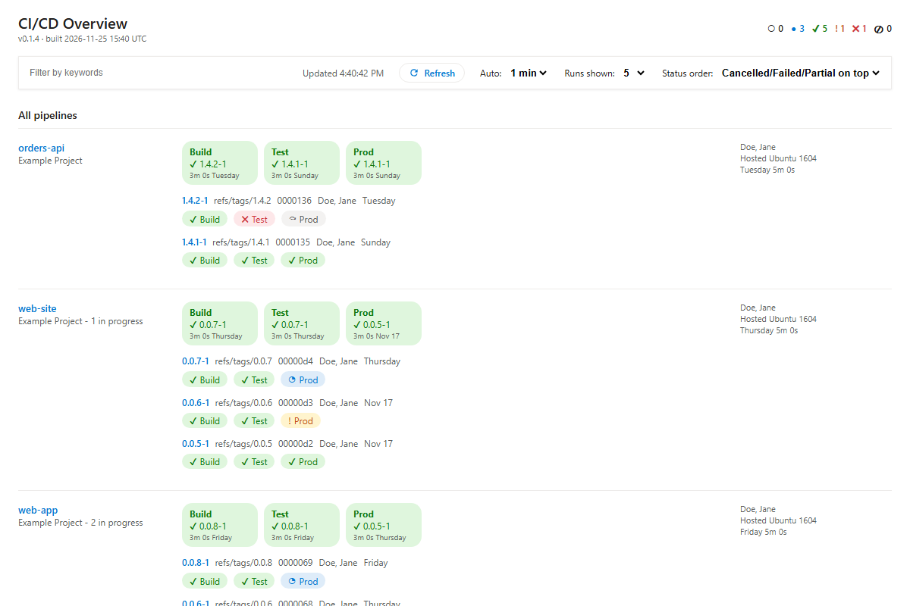

# CI/CD Overview

One page that shows what is running and what is deployed, across all pipelines in an Azure DevOps project.



## What you get

- **Latest deployment per stage** - for example which version is currently in Test and Prod.
- **Recent runs per pipeline** with a pill per stage (Build, Test, Prod ...), newest first.
- **Live status** - running stages show a spinner, and the page refreshes automatically.
- **Waiting for approval** - a stage that waits for approval is highlighted and links to the run, where you approve as usual.
- Filter by keyword, choose how many runs to show, and put failed, partial or cancelled pipelines on top.

## Permissions

Read-only. The extension only asks for `vso.build` and `vso.project`. It cannot start, change or approve anything.

## Where to find it

Once installed in an organization: **Pipelines > CI/CD Overview**.

## Development

Built with React, TypeScript, Vite and zustand.

```
npm install
npm run dev
```

Without any configuration the dev server shows built-in mock data, so no Azure DevOps access is needed.

### Run against live data

Copy `.env.example` to `.env.local` (git-ignored) and fill in your organization, project and a
personal access token with the scope **Build: Read** only.

```
ADO_ORG=your-organization
ADO_PROJECT=Your Project Name
ADO_PAT=...
```

The Vite dev server forwards calls to `dev.azure.com` and adds the token, so the token never reaches
the browser and no CORS setup is needed. Live data is only used by the dev server, never in a build.

### Package

```
npm run package
```

creates a `.vsix` in `dist-extension/`. Set your own `publisher` in `vss-extension.json` first.
The extension is private by default, so upload it to a publisher on the Visual Studio Marketplace
and share it with your organization.

## License

[MIT](LICENSE)
